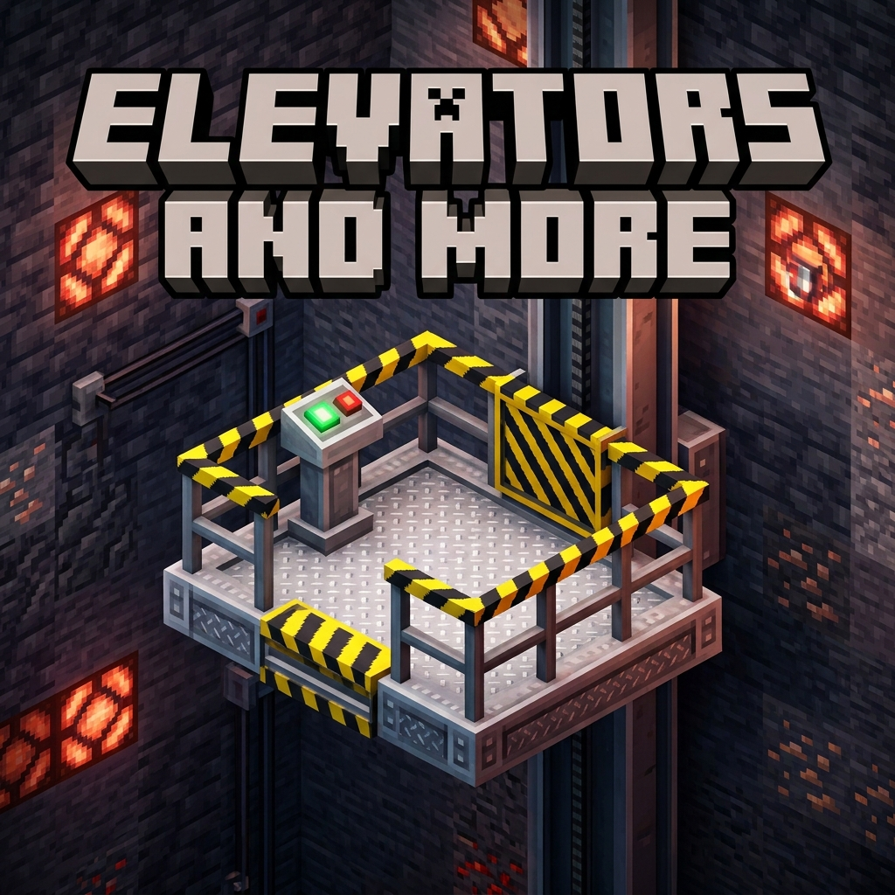

# Elevators and More

**Elevators and More** brings heavy-duty, realistic, multi-floor industrial elevators and travel utilities into Minecraft 26.3 with smooth entity movement and custom platform building!

Tired of simple instant-teleport elevators? Elevators and More lets you construct true dynamic elevator platforms with physical rails, wall call stations, onboard control pedestals, safety railings, and realistic mechanical sound effects.

---

## 🛗 Features at a Glance

- 🏗️ **Custom Platform Footprint**: Build platforms of any shape and size up to **49 blocks** (configurable up to 121 blocks) using `Industrial Elevator Floor` blocks.
- 🚡 **Smooth Moving Carriages**: Platforms smoothly turn into physical entities while in motion with collision and camera interpolation—no jittering or clipping through the floor!
- 📶 **Multi-Floor Shafts**: Place `Industrial Guide Rails` vertically from bedrock all the way to build height (up to 384+ blocks).
- 🎛️ **Elevator Control Boards (Landings)**:
  - Place control boards at each floor level.
  - Automatically discovers floors along the vertical shaft.
  - Includes a `DOCKED` indicator light so you know when the carriage is ready.
  - Call the elevator directly to your floor or send it anywhere.
  - Rename floor stops (e.g. *"Deepslate Quarry"*, *"Basement Storage"*, *"Penthouse"*).
- 🕹️ **Onboard Control Pedestal**:
  - Install a control column right on your moving platform.
  - Select your destination floor mid-ride or slam the **Emergency Stop** button if something is blocking your way.
- 🚧 **Industrial Safety Railings**: Keep your passengers, pets, and cargo securely on the platform.
- 🔊 **Atmospheric Audio**: Mechanical gear sounds, motor hums, and solid iron docking clunks when arriving at a floor.

---

## 📖 Quick Start Guide

### Step 1: Guide Rail Column
Place a vertical column of **Industrial Guide Rails** along the wall of your elevator shaft from bottom to top.

### Step 2: Build the Elevator Platform
At your desired starting level, construct the floor of your platform using **Industrial Elevator Floor** blocks touching or adjacent to the Guide Rail. Add **Industrial Safety Railings** around the perimeter and place an **Elevator Control Pedestal** on the floor so you can operate it from inside.

### Step 3: Install Floor Landing Boards
On each floor where you want the elevator to stop, mount an **Elevator Control Board** on the wall within 2 blocks of the platform edge. 

### Step 4: Configure & Ride!
Right-click your Control Board or Pedestal to open the custom GUI:
1. Rename the floor station if desired (e.g. *"Floor 1 - Base"*).
2. Press **Call Elevator Here** to bring the platform to your level.
3. Step aboard, open the pedestal interface, choose your destination, and hit **Go**!

---

## 🔨 Crafting Recipes

- **Industrial Guide Rail** (x6): 2 columns of Iron Ingots sandwiching Iron Bars in the middle.
- **Industrial Elevator Floor** (x4): 4 Iron Ingots cross-pattern around Smooth Stone.
- **Industrial Safety Railing** (x6): 3 Iron Bars along top, 2 Yellow Dye below.
- **Elevator Control Board** (x2): Stone Button flanked by Redstone Torches, with Iron Ingots top and bottom.
- **Elevator Control Pedestal** (x1): Stone Button on top, Redstone in the middle, Iron Ingot on bottom.

---

## ⚙️ Configuration Options

Server admins and pack makers can configure the following in the config file:
- **`maxPlatformBlocks`**: Maximum number of platform floor blocks (Default: `49`, Max: `121`).
- **`maxHorizontalSpan`**: Maximum horizontal reach from the guide rail (Default: `7`).
- **`maxShaftHeight`**: Maximum vertical travel height (Default: `384` blocks).
- **`elevatorSpeed`**: Travel speed in blocks per tick (Default: `0.20` = 4 blocks per second).

---

## 📌 Requirements

- **Minecraft**: 26.3
- **Mod Loader**: NeoForge (version 26.3.0.48-beta or later)
- **Environment**: Client and Server required.

---

## 💬 Modpacks & Permissions

You are welcome to include **Elevators and More** in any public or private modpack!
